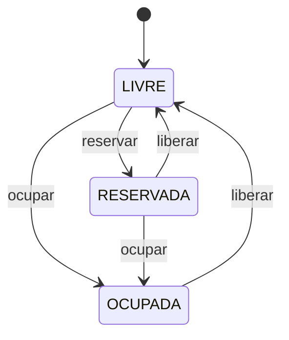
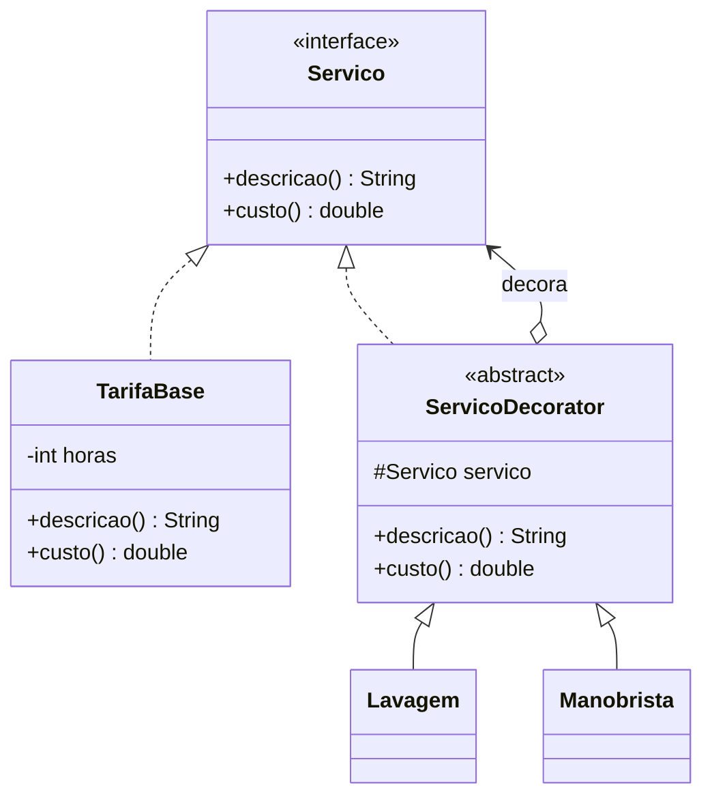

# Estacionamento — State e Decorator

## Descrição do sistema

(a preencher)

## Tecnologias e pré-requisitos

- JDK 21
- Maven 3.9+
- Java 21
- Spring Boot 3.3.5

## Como executar

```bash
mvn spring-boot:run
```

Após iniciar a aplicação, acesse: [http://localhost:8080](http://localhost:8080).

## Exemplos de uso

A API REST fica em `http://localhost:8080/api`. Todos os dados são mantidos em
memória e se perdem ao reiniciar a aplicação.

### Endpoints

| Método | Rota | Corpo | Descrição |
| --- | --- | --- | --- |
| GET | `/api/vagas` | — | Lista as vagas com o estado atual |
| POST | `/api/vagas` | `{"numero": 1}` | Cria uma vaga (estado inicial `LIVRE`) |
| POST | `/api/vagas/{id}/reservar` | — | Livre → Reservada |
| POST | `/api/vagas/{id}/liberar` | — | Reservada → Livre (cancela a reserva) |
| GET | `/api/permanencias` | — | Lista as permanências ativas e finalizadas |
| POST | `/api/permanencias` | `{"placa", "modelo", "vagaId"}` | Registra a entrada e ocupa a vaga |
| POST | `/api/permanencias/{id}/servicos` | `{"tipo": "LAVAGEM"}` ou `{"tipo": "MANOBRISTA"}` | Adiciona um serviço extra |
| POST | `/api/permanencias/{id}/saida` | — | Calcula o total e libera a vaga |

### Respostas de erro

Todos os erros retornam o corpo `{"erro": "mensagem"}`:

| Status | Quando |
| --- | --- |
| `409 Conflict` | Transição de estado inválida (ex.: ocupar uma vaga ocupada), serviço já adicionado, serviço ou saída em permanência finalizada, número de vaga repetido, veículo já estacionado, liberar manualmente uma vaga ocupada (use a saída) |
| `404 Not Found` | Vaga ou permanência inexistente |
| `400 Bad Request` | Corpo ausente/inválido, campos obrigatórios vazios ou tipo de serviço desconhecido |

### Fluxo completo com `curl`

Os comandos abaixo usam a sintaxe do Bash (Linux, macOS ou Git Bash no
Windows) e seguem o fluxo de demonstração do projeto.

**1. Criar 3 vagas**

```bash
curl -X POST http://localhost:8080/api/vagas -H "Content-Type: application/json" -d '{"numero": 1}'
curl -X POST http://localhost:8080/api/vagas -H "Content-Type: application/json" -d '{"numero": 2}'
curl -X POST http://localhost:8080/api/vagas -H "Content-Type: application/json" -d '{"numero": 3}'
```

```json
{"id":1,"numero":1,"estado":"LIVRE"}
```

**2. Reservar a vaga 1**

```bash
curl -X POST http://localhost:8080/api/vagas/1/reservar
```

```json
{"id":1,"numero":1,"estado":"RESERVADA"}
```

**3. Registrar a entrada de um veículo na vaga 2 (Livre → Ocupada)**

```bash
curl -X POST http://localhost:8080/api/permanencias -H "Content-Type: application/json" \
  -d '{"placa": "ABC1D23", "modelo": "Gol", "vagaId": 2}'
```

```json
{"id":1,"vagaId":2,"vagaNumero":2,"placa":"ABC1D23","modelo":"Gol",
 "entrada":"2026-11-10T14:00:00","saida":null,"ativa":true,"servicos":[],
 "descricao":"Tarifa 1h","valorAtual":10.0,"valorTotal":null}
```

**4. Tentar ocupar a vaga 2 de novo (erro de transição)**

```bash
curl -i -X POST http://localhost:8080/api/permanencias -H "Content-Type: application/json" \
  -d '{"placa": "XYZ9K87", "modelo": "Uno", "vagaId": 2}'
```

```text
HTTP/1.1 409
{"erro":"Não é possível ocupar uma vaga no estado OCUPADA"}
```

**5. Adicionar Lavagem e Manobrista à permanência**

```bash
curl -X POST http://localhost:8080/api/permanencias/1/servicos -H "Content-Type: application/json" -d '{"tipo": "LAVAGEM"}'
curl -X POST http://localhost:8080/api/permanencias/1/servicos -H "Content-Type: application/json" -d '{"tipo": "MANOBRISTA"}'
```

```json
{"id":1, "...":"...", "servicos":["LAVAGEM","MANOBRISTA"],
 "descricao":"Tarifa 1h + Lavagem + Manobrista","valorAtual":60.0,"valorTotal":null}
```

Adicionar o mesmo serviço duas vezes retorna `409`.

**6. Registrar a saída (tarifa + extras somados, vaga volta a Livre)**

```bash
curl -X POST http://localhost:8080/api/permanencias/1/saida
```

```json
{"id":1,"vagaId":2,"vagaNumero":2,"placa":"ABC1D23","modelo":"Gol",
 "entrada":"2026-11-10T14:00:00","saida":"2026-11-10T16:30:00","ativa":false,
 "servicos":["LAVAGEM","MANOBRISTA"],"descricao":"Tarifa 3h + Lavagem + Manobrista",
 "valorAtual":80.0,"valorTotal":80.0}
```

A tarifa base cobra R$ 10,00 por hora; fração de hora é cobrada como hora
cheia, com mínimo de 1h (no exemplo, 2h30 → 3h; 58 min → 1h). Enquanto a permanência está ativa, `valorTotal` é `null` e
`valorAtual` mostra a cobrança parcial até o momento.

**7. Consultar vagas e permanências**

```bash
curl http://localhost:8080/api/vagas
curl http://localhost:8080/api/permanencias
```

```json
[{"id":1,"numero":1,"estado":"RESERVADA"},
 {"id":2,"numero":2,"estado":"LIVRE"},
 {"id":3,"numero":3,"estado":"LIVRE"}]
```

**8. Cancelar a reserva da vaga 1 (Reservada → Livre)**

```bash
curl -X POST http://localhost:8080/api/vagas/1/liberar
```

```json
{"id":1,"numero":1,"estado":"LIVRE"}
```

## Patterns utilizados

### State

**Problema resolvido:** uma vaga pode assumir diferentes estados, e cada estado
possui regras próprias para as operações de ocupar, liberar e reservar. O padrão
State evita concentrar essas regras em condicionais `if/else` ou `switch` na
classe `Vaga`, mantendo cada comportamento no estado correspondente. Assim,
novos estados podem ser adicionados criando uma nova classe que implemente
`EstadoVaga`, com alterações mínimas nas classes existentes.

**Classes envolvidas:**

- `Vaga`: contexto do padrão. Mantém a referência para o estado atual e delega
  as operações de ocupar, liberar e reservar para esse estado.
- `EstadoVaga`: estado abstrato representado por uma interface. Define o
  contrato comum para as transições e para a identificação do estado.
- `VagaLivre`: estado concreto de uma vaga disponível.
- `VagaOcupada`: estado concreto de uma vaga atualmente ocupada.
- `VagaReservada`: estado concreto de uma vaga reservada.
- `TransicaoInvalidaException`: exceção lançada quando uma operação não é
  permitida no estado atual.



### Decorator

**Problema resolvido:** durante a permanência, o cliente pode contratar serviços
extras (lavagem, manobrista) em qualquer combinação e ordem. Criar uma subclasse
para cada combinação (`TarifaComLavagem`, `TarifaComLavagemEManobrista`, ...)
causaria uma explosão de classes, e usar flags booleanas com `if` em uma única
classe obrigaria a alterá-la a cada novo serviço. Com o Decorator, cada extra é
uma classe pequena que "embrulha" outro `Servico` e acrescenta sua descrição e
seu custo. As combinações são montadas em tempo de execução, e um novo serviço
(por exemplo, `RecargaEletrica`) exige apenas uma nova subclasse de
`ServicoDecorator`, sem alterar as classes existentes.

**Classes envolvidas:**

- `Servico`: componente (interface). Define `descricao()` e `custo()`.
- `TarifaBase`: componente concreto. Cobra valor por hora × horas
  (R$ 10,00/h).
- `ServicoDecorator`: decorator abstrato. Implementa `Servico` e guarda uma
  referência ao `Servico` decorado, repassando as chamadas a ele.
- `Lavagem`: decorator concreto, acrescenta R$ 30,00.
- `Manobrista`: decorator concreto, acrescenta R$ 20,00.



**Exemplo de composição:**

```java
Servico servico = new Manobrista(new Lavagem(new TarifaBase(2)));

servico.descricao(); // "Tarifa 2h + Lavagem + Manobrista"
servico.custo();     // 20.0 + 30.0 + 20.0 = 70.0
```

Cada chamada percorre a cadeia de fora para dentro: `Manobrista` pede a
descrição/custo à `Lavagem`, que pede à `TarifaBase`; na volta, cada camada
soma a sua parte.

## Declaração de uso de IA

| Parte | Modelo | Onde foi utilizada |
| --- | --- | --- |
| Setup e State | Codex, baseado no GPT-5 | Apoio à criação do esqueleto inicial do projeto, implementação do padrão State, testes e documentação. |
| Decorator | Claude Opus 5.5 (Anthropic) | Implementação das classes do pacote `servico` (`TarifaBase`, `ServicoDecorator`, `Lavagem`, `Manobrista`), testes unitários e seção Decorator deste README. Código revisado e testado pelo integrante responsável. |
| Domínio, serviço e API | Claude Opus 5.5 (Anthropic) | Implementação dos pacotes `dominio` (`Veiculo`, `Permanencia`, `TipoServico`), `aplicacao` (`EstacionamentoService` e repositórios em memória) e `api` (controllers, DTOs e tratamento de erros), testes unitários e de integração e seção "Exemplos de uso" deste README. Código revisado e testado pelo integrante responsável. |

## Contribuição de cada integrante

| Integrante | GitHub | Contribuição |
| --- | --- | --- |
| Ana Laura | [anaavicenzi](https://github.com/anaavicenzi) | Implementação do padrão State (estados da Vaga e testes). |
| Octavio | [octaviodemos](https://github.com/octaviodemos) | Implementação do padrão Decorator (serviços extras Lavagem e Manobrista, tarifa base e testes) e seção Decorator do README. |
| Lucas | [LucasMagenis](https://github.com/LucasMagenis) | Domínio (`Veiculo`, `Permanencia`), `EstacionamentoService`, repositórios em memória, API REST (controllers, DTOs, tratamento de erros → HTTP 409), testes e seção "Exemplos de uso" do README. |
| (a preencher) | (a preencher) | (a preencher) |
