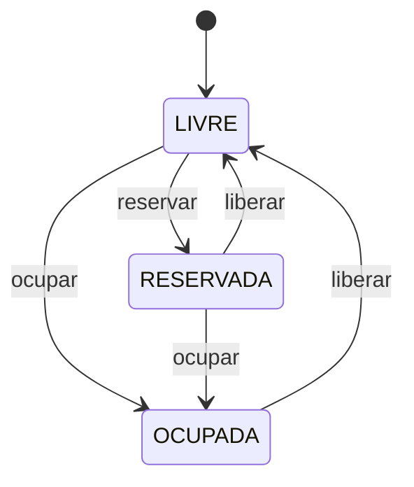

# Estacionamento — State e Decorator

## Descrição do sistema

(a preencher)

## Tecnologias e pré-requisitos

- JDK 17
- Maven 3.9+
- Java 17
- Spring Boot 3.3.5

## Como executar

```bash
mvn spring-boot:run
```

Após iniciar a aplicação, acesse: [http://localhost:8080](http://localhost:8080).

## Exemplos de uso

(a preencher)

## Patterns utilizados

### State

**Problema resolvido:** uma vaga pode assumir diferentes estados, e cada estado
possui regras próprias para as operações de ocupar, liberar e reservar. O padrão
State evita concentrar essas regras em condicionais `if/else` ou `switch` na
classe `Vaga`, mantendo cada comportamento no estado correspondente. Assim,
novos estados podem ser adicionados criando uma nova classe que implemente
`EstadoVaga`, com alterações mínimas nas classes existentes.

**Classes envolvidas:**

- `Vaga`: contexto do padrão. Mantém a referência para o estado atual e delega
  as operações de ocupar, liberar e reservar para esse estado.
- `EstadoVaga`: estado abstrato representado por uma interface. Define o
  contrato comum para as transições e para a identificação do estado.
- `VagaLivre`: estado concreto de uma vaga disponível.
- `VagaOcupada`: estado concreto de uma vaga atualmente ocupada.
- `VagaReservada`: estado concreto de uma vaga reservada.
- `TransicaoInvalidaException`: exceção lançada quando uma operação não é
  permitida no estado atual.



### Decorator

Classes envolvidas: (a preencher)

Problema resolvido: (a preencher)

## Declaração de uso de IA

Modelo usado: Codex, baseado no GPT-5.

Partes em que foi utilizada: apoio à criação do esqueleto inicial do projeto,
implementação do padrão State, testes e documentação.

## Contribuição de cada integrante

| Integrante | GitHub | Contribuição |
| --- | --- | --- |
| Ana Laura | [anaavicenzi](https://github.com/anaavicenzi) | Implementação do padrão State (estados da Vaga e testes). |
| (a preencher) | (a preencher) | (a preencher) |
